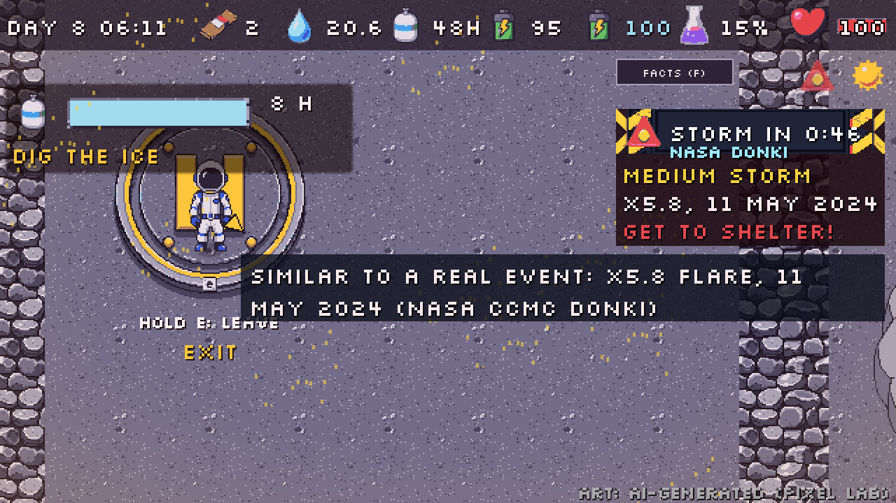

# Junior Astronaut Mission Trainer

A 2D top-down game for kids 7-12, made for the **NASA Space Apps Challenge 2026 (Cairo)**, challenge
"Build a Junior Astronaut Mission Trainer". You run a small lunar south-pole outpost for 32 days: balance power, oxygen,
water, food and health, collect samples, hide from solar storms, and survive the crater-rim shadow days.
Godot 4.7.2 (GDScript), web export for itch.io.

Team **Wings of wax**: Ahmed Mohammed Mohammed Ahmed Taha, Mohamed Anas.

| | |
|---|---|
| **Play in the browser** (desktop, keyboard) | https://me-amm.itch.io/lunar-post-survival |
| **30-second demo video** | https://youtu.be/eqXDSytL5EY |
| **Project intro video** (local event application) | https://youtu.be/_21kd5jMerY |
| **Project description (PDF)** | [docs/Project_Description.pdf](docs/Project_Description.pdf) |
| **Research report with all sources** | [docs/Lunar_Outpost_Research_Report.pdf](docs/Lunar_Outpost_Research_Report.pdf) |

**Short on time?** Click **Judge mode** on the title screen and jump to day 8 (storm during a mission), day 11 (shadow) or day 24 (big storm). Press **J** any time in Judge mode to reopen the panel.

## Where to see the NASA data
- Every storm panel names the real flare it copies (class, date) and its source (NASA DONKI, or NOAA / ESA for 2003).
- **Space Weather Log** (Title button, or L at the forecast board): the 8 storms with game day, flare class, real date, DONKI flrID, source, and a tick for storms you survived. *Every storm in this game copies a real solar flare.*
- Info cards end with their source line; **Facts (F)** in the HUD reopens every card seen; the endings list "What you learned".

## Screenshots
`docs/screenshots/` (1280x720, made with `tools/capture.tscn` in Video mode).

## Controls
Arrows or WASD to move, **E** to interact (hold E for 2 s to clean a panel or swap power packs), Esc opens the pause menu (save / quit), **F** Fact log, **M** mutes, **F3** shows collision and interaction areas. Judge panel: **Video mode** hides the debug labels for clean recording (the AI watermark stays).

## Real NASA data used
- **NASA CCMC DONKI** (space weather database): the 8 storms in the game are labelled with real solar flares. The archive was downloaded once
  from the CCMC host (`tools/fetch_donki.py` -> `data/donki_events.json`); the game makes no live calls.
- **NASA OSDR** (study OSD-804, mice on the Space Station): the gym info card.
- **ISS radiation measurements: DOSIS 3D-DOSTEL (Berger et al., 2018)**: the storm radiation info card.
- **Canadian Space Agency, Food production on the Moon toolkit**: the radish info card.
- Other facts on the info cards come from public NASA material (see each card's source line in `data/text.json`).

## The 8 storms and their real events
| Day | Storm | Real event |
|---|---|---|
| 4 | Small #1 | M-class flare, 3 May 2024 (DONKI) |
| 8 | Medium | X5.8 flare, 11 May 2024 (DONKI) |
| 10 | Small #2 | M-class flare, 4 May 2024 (DONKI) |
| 14 | Small #3 | M-class flare, 5 May 2024 (DONKI) |
| 15 | Small #4 | M-class flare, 6 May 2024 (DONKI) |
| 20 | Small #5 | M-class flare, 7 May 2024 (DONKI) |
| 24 | Large | X9.0 flare, 3 Oct 2024 (DONKI) |
| 32 | Finale | X28 flare, 4 Nov 2003 (NOAA / ESA, hand-entered; the brightest X-ray flare ever measured) |

The game's damage rules are game rules, not real physics.

## How to run
Open this folder in **Godot 4.7.2** and press F5, or export the "Web" preset
(`godot --headless --path . --export-release "Web" build/web/index.html`) and serve `build/web/`.
Design documents are in `docs/` (rulebook, day script, decisions, collision notes). Check scripts live in `tools/`
(`sim_check.gd` plays all 32 days; `collision_check.gd`; `ui_check.gd`).

## AI use statement
Shown in the game: a permanent "Art: AI-generated (Pixel Lab)" watermark on every screen, and "Art: AI-generated (Pixel Lab). Code: AI-assisted (Claude Code). Sound: generated by a script." on the Title and Credits. Every WAV file carries a LIST/INFO chunk (ISFT "Python script", ICMT "SI-generated audio, NASA Space Apps Cairo 2026"); every .gd/.py file starts with an AI-assisted code header.

- **Art:** AI-generated pixel art made with Pixel Lab during the event, recolored and composed with Python scripts (prompts in `docs/art/sprite_prompts.csv`). HUD icons are 32x32 copies resized by script (`assets_derived/`).
- **Code and research help:** written with AI assistance (Claude / Claude Code by Anthropic), tested and adjusted by the team during the event.
- **Sound:** sound effects generated by a script (`tools/make_sfx.py`) during the event; they can be replaced by jsfxr files of the same name.
- **Font:** Silkscreen by Jason Kottke, SIL Open Font License 1.1 (`fonts/LICENSE`), chosen because its digits (3, 5, 8, 9) stay clearly different at small sizes.

## Credits
Made with Godot Engine. Space weather data: NASA CCMC DONKI. The 2003 flare: NOAA / ESA. NASA OSDR, ISS radiation measurements (DOSIS 3D-DOSTEL, Berger et al., 2018) and the Canadian Space Agency as above.

**This game is not endorsed by NASA.** No NASA logos are used.
